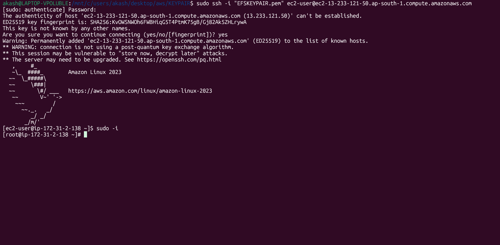
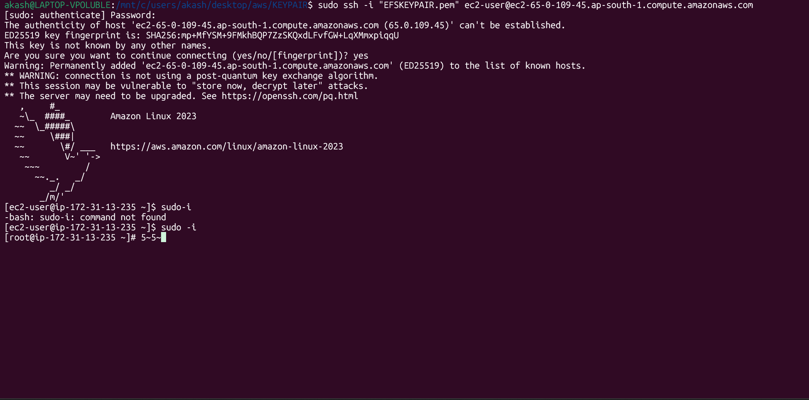
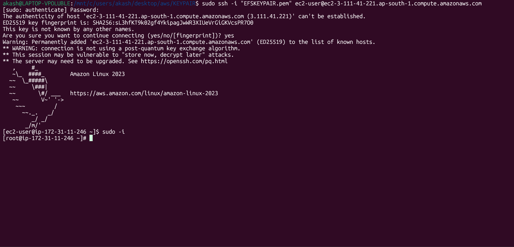

# AWS EFS Shared Storage Across Three EC2 Instances

**Hands-on AWS Cloud Project | Linux | Network File System (NFS)**

## 📌 Project Overview

This project demonstrates how to configure Amazon Elastic File System (EFS) as shared storage across three Amazon EC2 instances.

Using Linux commands and NFSv4.1, I mounted the same EFS file system on three EC2 instances and verified that files created on the shared storage could be accessed from the other instances.

## 🎯 Project Objectives

- Create and configure an Amazon EFS file system.
- Connect EFS to three EC2 instances within the same VPC.
- Mount the shared file system using Linux commands.
- Verify shared file access across multiple EC2 instances.
- Understand how network file storage supports shared access between servers.

## 🛠️ AWS Services and Technologies

| Service / Technology | Purpose |
|---|---|
| Amazon EC2 | Hosts the three Linux instances |
| Amazon EFS | Provides shared, elastic file storage |
| Amazon VPC | Provides the network environment |
| Amazon Linux | Operating system used on the EC2 instances |
| NFSv4.1 | Protocol used to mount and access EFS |
| Linux CLI | Used for mounting and file-management operations |

## 🏗️ Architecture

Three EC2 instances connect to the same Amazon EFS file system through their network interfaces and EFS mount targets.

**Architecture flow:**

`EC2 Instance 1 ─┐`

`EC2 Instance 2 ─┼── Amazon EFS`

`EC2 Instance 3 ─┘`

Each instance mounts the shared file system, allowing files stored in EFS to be accessed from all three instances, subject to network and file permissions.

## ⚙️ Implementation Steps

### 1. Create the EFS File System

- Created an Amazon EFS file system.
- Used the default VPC for the lab.
- Identified the EFS mount target IP address for connectivity.

### 2. Connect to the EC2 Instances

- Connected to three Amazon Linux EC2 instances.
- Used the Linux terminal to perform the storage configuration.

### 3. Mount EFS on the Instances

Created a directory to use as the mount point:

```bash
mkdir folder3
```

Mounted the EFS file system using NFSv4.1:

```bash
sudo mount -t nfs4 -o nfsvers=4.1,rsize=1048576,wsize=1048576,hard,timeo=600,retrans=2,noresvport <EFS-MOUNT-TARGET-IP>:/ folder3
```

Replace `<EFS-MOUNT-TARGET-IP>` with the appropriate mount target IP address.

Repeated the mounting process on the other EC2 instances.

### 4. Verify Shared File Access

Navigated to the mounted directory:

```bash
cd folder3
```

Listed the files:

```bash
ls -la
```

Created files on the shared filesystem and checked their availability from the other EC2 instances.

**Result:** Verified that files stored on the shared EFS filesystem could be accessed across all three instances.

## 🧪 Validation

The project involved checking that:

- EFS was mounted on all three EC2 instances.
- Files created on the shared filesystem were visible from the other instances.
- The same shared storage was accessible through each instance's mount point.

## 📚 Key Learning Outcomes

- Understanding Amazon EFS and shared network file storage.
- Mounting an AWS-managed filesystem on Linux EC2 instances.
- Working with NFSv4.1 mount options.
- Understanding how multiple EC2 instances can access a common filesystem.
- Practicing Linux directory and file-management commands.
- Understanding the importance of VPC connectivity and security group configuration for EFS access.
## 📸 Project Screenshots

### 1. EC2 Instance 1 — EFS Connection



### 2. EC2 Instance 2 — EFS Connection



### 3. EC2 Instance 3 — EFS Connection



### 4. EFS Mount and Configuration Evidence


### 5. Shared Storage Verification


### 6. Shared Storage Testing


### 7. Additional Verification


## 💰 Cost Management and Cleanup

Amazon EFS storage and related AWS resources may incur charges.

After completing the lab:

- Unmount EFS from the EC2 instances if no longer needed.
- Delete the EFS file system if it is no longer required.
- Terminate unused EC2 instances.
- Review remaining mount targets and other resources before finishing cleanup.

## 👨‍💻 Author

**Akash K**

GitHub: [Akash-k1](https://github.com/Akash-k1)

**Focus Areas:** AWS Cloud, Linux, Storage, Networking, and DevOps
